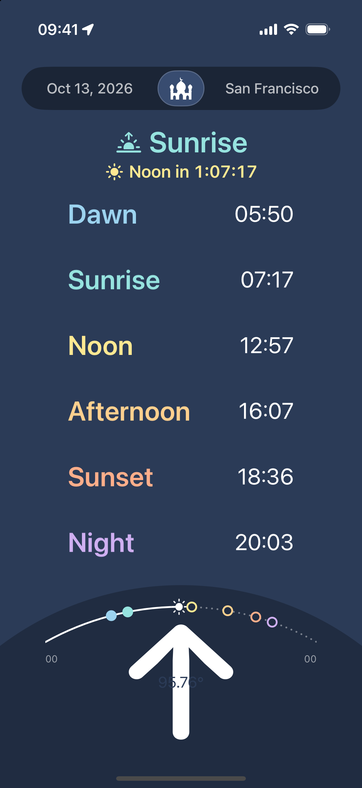
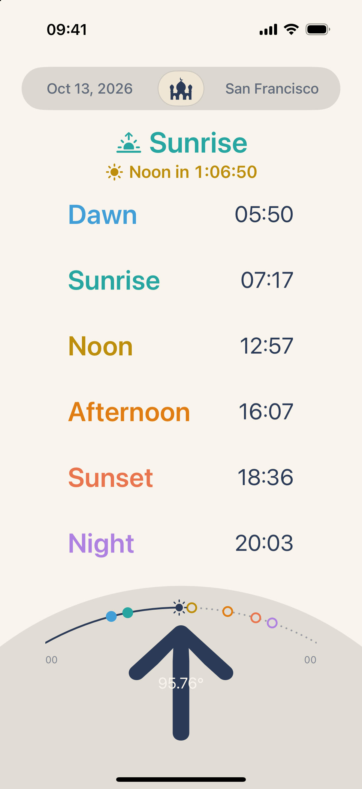
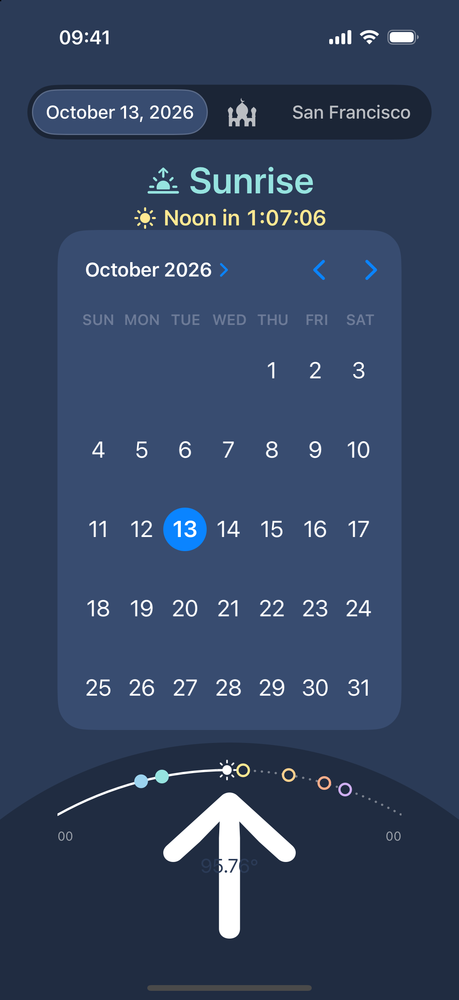
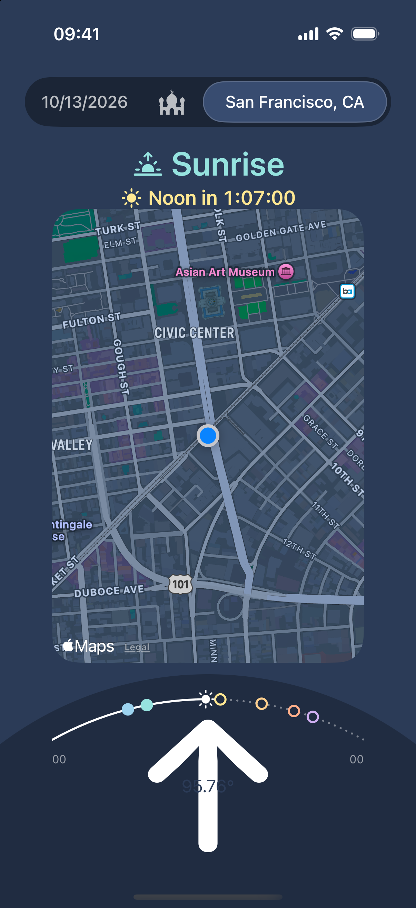

<h1 align="center">Salat</h1>

<p align="center">
  A fast, accurate and minimal prayer times app for iOS.<br>
  Prayer times, a live countdown, Qibla direction, reminders and widgets. No ads, no accounts, no clutter.
</p>

<p align="center">
  
  &nbsp;&nbsp;
  
</p>

Salat started as a personal tool and became the app my community uses every day. They asked for no ads, no distractions and no unnecessary features, just a prayer utility that is quick, correct and easy on the eyes. That brief is still the design spec.

## Contents

- [Features](#features)
- [How it works](#how-it-works)
- [Design principles](#design-principles)
- [Building](#building)
- [Project layout](#project-layout)
- [Testing](#testing)
- [Privacy](#privacy)
- [Credits](#credits)

## Features

### Prayer times at a glance

The home screen lists the six times of the day for your current location, each in its own color so a quick look is enough:

| Name | Meaning |
| --- | --- |
| Dawn | Start of the morning prayer (sun 18 degrees below the horizon) |
| Sunrise | End of the morning prayer |
| Noon | Solar noon, start of the midday prayer |
| Afternoon | Start of the afternoon prayer (shadow length equals object height plus its noon shadow) |
| Sunset | Start of the evening prayer |
| Night | Start of the night prayer (sun 18 degrees below the horizon) |

Times are computed on the device from your coordinates, so Salat works offline and never sends your location to a server.

### Live status and countdown

Under the header, Salat shows the prayer currently in effect and a ticking countdown to the next one. Before dawn it correctly reports the previous night's Night prayer. The countdown always follows the real clock, even when you are browsing a different date.

### Day timeline

The curved timeline above the compass shows the whole day from midnight to midnight, with one dot per prayer. A solid line marks the time already passed, dotted line and hollow dots mark what is still ahead, and a sun marker moves along the arc as the day goes by.

### Qibla compass

A single arrow points toward the Kaaba using the device's true-north heading. It updates continuously as you turn, gives light haptic ticks while you rotate, and a firmer tap when you are facing the Qibla. The bearing in degrees is shown on the arrow.

### Date and location selector

The pill at the top is the only navigation in the app.

<table>
  <tr>
    <td align="center"></td>
    <td align="center"></td>
  </tr>
  <tr>
    <td align="center"><b>Date</b><br>Tap the date to open a calendar and see the times for any day. Today is restored automatically when you reopen the app or when midnight passes.</td>
    <td align="center"><b>Location</b><br>Tap the place name to see your position on a map. The name shortens itself to fit narrow screens.</td>
  </tr>
</table>

Tap the mosque glyph in the middle, or tap the active panel again, to return to the prayer times.

### Reminders

Salat can notify you five minutes before each prayer begins. The notification names the upcoming prayer, says which prayer is ending and where you are.

- Reminders are marked time sensitive, so they can break through Focus modes.
- Permission is requested the first time there is something to schedule, and Salat respects whatever you choose in Settings afterward. If notifications are turned off, nothing is left pending.
- Reminders are planned about ten days ahead and re-planned every time you open the app or move. Close to the end of that window one extra notification asks you to open Salat again, so reminders do not quietly run out.
- Changing city, or a prayer moving by a few minutes with the season, rebuilds the plan. GPS jitter does not.

### Widgets

All widgets read a location the app shares through an App Group and compute their own timelines, so they never need to wake up for a location lookup.

| Widget | Sizes | Shows |
| --- | --- | --- |
| Prayer Times | Small | Current prayer, next prayer and time, countdown, day timeline |
| Prayer Times | Medium | Date, location, the day's six times in two columns with the current one highlighted, day timeline |
| Prayer Times | Large | Date, location, full day table, day timeline, countdown to the next prayer and the Qibla bearing with a rotated arrow |
| Prayer Times | Lock screen: rectangular, circular, inline | Current prayer, next time, progress gauge |
| Qibla | Lock screen: circular, inline | Direction of the Qibla around a ring, with north at the top |

A widget cannot read the compass, so the Qibla widget shows the bearing as a map direction: face north and the dot shows where to turn.

### Appearance

Salat follows the system light and dark appearance, with a tuned palette for each. The layout adapts to every iPhone screen size and respects Bold Text. Portrait only on iPhone.

## How it works

**Prayer times.** `SalatTimes` is a port of the solar position math from [SunCalc](https://github.com/mourner/suncalc). For a date and coordinate it solves for solar noon, then derives the other times from the sun's altitude: -18 degrees for Dawn and Night, -0.833 degrees for Sunrise and Sunset, and a shadow-length rule for Afternoon. Calculation is anchored at local noon, so the result always belongs to the right calendar day. At high latitudes where the sun never reaches an angle (for example -18 degrees in a Moscow summer), that time is omitted rather than shown as an invalid date.

**Qibla.** `Qibla.bearing` computes the direction from your position to the Kaaba (21.4225, 39.8262). It is defined everywhere, including at the Kaaba itself. The compass combines it with the device's true heading to rotate the arrow.

**Location.** Prayer times and Qibla only need a rough position, so Salat asks for kilometer accuracy with a 1 km distance filter and also monitors significant location changes. Location updates run only while the app is on screen. The place name is resolved with reverse geocoding and is only ever attached to the coordinate it was resolved for.

**Widgets.** `PrayerSchedule.timeline` precomputes snapshots for roughly the next 30 hours: one at every prayer, one at each midnight so the list rolls over to the new day, and one every hour to keep gauges moving. WidgetKit then flips between entries by itself.

**Reminders.** `ReminderPlanner` is pure logic that turns a location and a time into a list of reminders, capped under the 64 pending notifications iOS allows. `ReminderScheduler` reconciles that plan with what is actually pending, serializing overlapping requests so duplicates cannot occur.

## Design principles

- **Instant access.** What you need is on the first screen. No menus to dig through.
- **Visual clarity.** Peek and move on. Each prayer has a consistent color across the app, the widgets and the timeline.
- **Lightweight.** No third-party dependencies, no networking beyond Apple's own geocoding and map tiles, minimal battery use.
- **Quiet.** No ads, no account, no analytics, no onboarding.

## Building

Requirements:

- Xcode 16 or later
- iOS 18.0 deployment target

```bash
git clone https://github.com/parsasaray/Salat.git
cd Salat
open Salat.xcodeproj
```

Select the **Salat** scheme and run on a simulator or device. In the simulator, set a location with **Features > Location** to see prayer times for a given place.

To run on a device or to use the widgets you will need to set your own development team, and change the bundle identifiers and the App Group (`group.com.psaray.salat`) to ones you own, in both the app and the widget extension.

## Project layout

```
Salat/
  Delegates/        App, scene and location delegates
  Libraries/        Solar math, Qibla, prayer schedule, reminder planner and scheduler,
                    shared location store, day timeline layout
  Views/            Header pill, status, timeline and compass views
Salat Widget/       WidgetKit extension: prayer and Qibla widgets, theme
SalatTests/         Unit tests
```

## Testing

```bash
xcodebuild test \
  -project Salat.xcodeproj \
  -scheme Salat \
  -destination 'platform=iOS Simulator,name=iPhone 16 Pro'
```

The unit tests cover prayer time calculation, Qibla bearings, reminder planning and scheduling (against a fake notification store), and the widget snapshot logic.

## Privacy

Your location is used on the device to calculate prayer times and the Qibla, and is shared only with Salat's own widgets through an App Group. Salat has no server, no analytics and no tracking. Place names and map tiles come from Apple's frameworks.

## Credits

- Solar calculations are ported from [SunCalc](https://github.com/mourner/suncalc) by Vladimir Agafonkin, via a Swift port by Cristian Gonzales.
- Designed and built by Parsa Saraydarpour.
